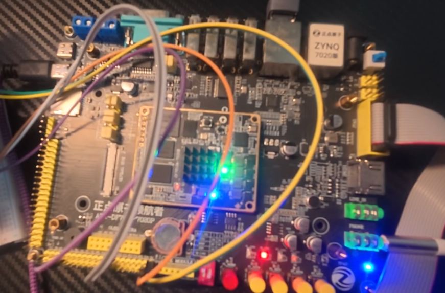
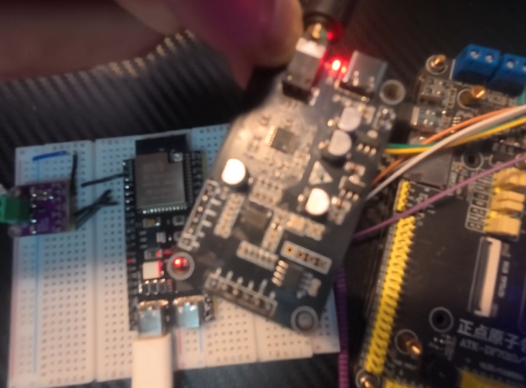
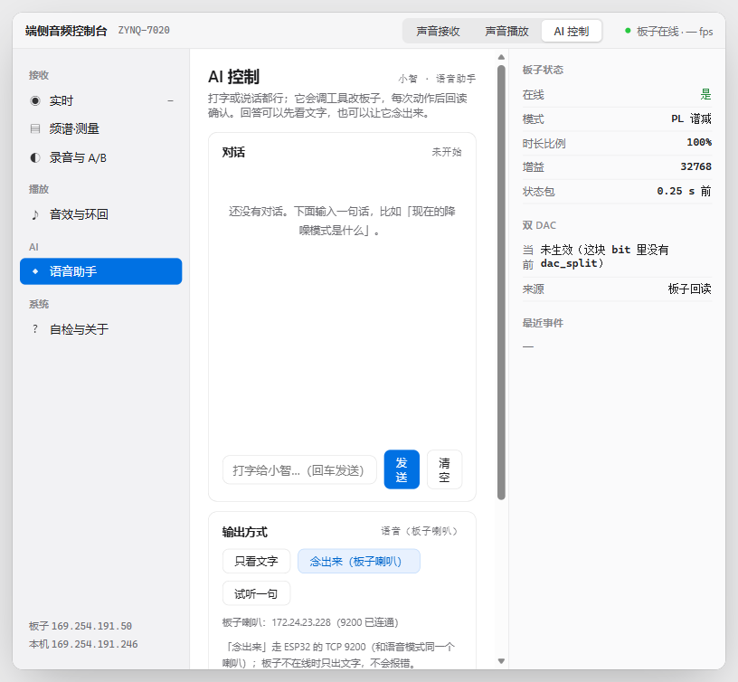
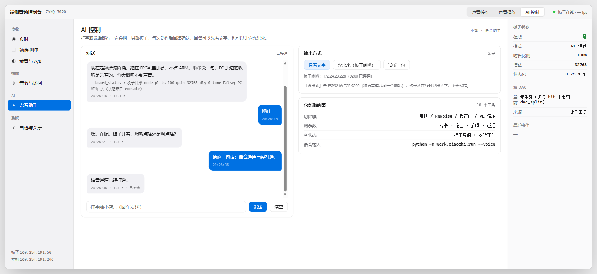

# AI解码器——基于 ZYNQ-7020 的端侧实时音频采集、降噪与语音交互系统

## 摘要

本作品在一块 ZYNQ-7020（xc7z020clg400-2）板卡上打通了"模拟声—数字帧—网络包—界面—声音"的全链路。PL 侧用硬件产生 I2S 时序（LRCK 48 kHz、BCLK 1.536 MHz），把麦克风采样逐位解串、拼成立体声字，经异步 FIFO 跨到 100 MHz 域，由 DMA 送入 DDR；PS 侧把每 10 ms 的 1920 字节帧封成两个 968 字节的 UDP 包，以 100 帧/秒的稳定节奏发往电脑，端到端抖动为零。电脑端控制台提供实时波形、频谱、DBFS 与丢包统计，并能在同一界面完成三档降噪（旁路、RNNoise、噪声门）切换、录音与 A/B 对比。控制台还接入了大模型语音助手：用文字提问，助手可以读取板子真实状态、改参数，并按"只看文字"或"念出来（板子喇叭）"两种方式作答，语音经 ESP32 与数字功放输出。

实测：上行帧率 100.0 帧/秒（6 秒内三次采样 98.9–100.2），丢包 0，吞吐 1.549 Mbit/s；实现后 WNS +0.357 ns、WHS +0.024 ns，零失败端点；资源 Slice LUT 19656（36.95%）、寄存器 48299、BRAM 8 块、DSP 0，片上功耗 2.189 W。降噪的谱减算法已用 512 点定点 FFT 在 PL 内实现并通过与 Python 黄金模型的逐点比对，但当版本尚未接入数据通路，这一项目前只做到"仿真通过"，本报告如实标注，详见第四部分与 `docs/known_issues.md`。

作品同时留下了一套可复用的工程方法：把"重新综合就 0 包"这类偶发故障，从猜测变成"先查约束再查逻辑"的固定判据，并整理成技能包。

## 第一部分 作品概述

### 1.1 功能与特性

系统对外提供四项能力。**采集上行**：麦克风声音经板载音频编解码器进入 PL，硬件定长成帧后以 100 帧/秒发往电脑，控制台实时显示波形、频谱、DBFS 与丢包/欠载计数。**降噪切换**：旁路、RNNoise、噪声门三档可在线切换，切换命令走独立的控制端口，板子每 250 ms 回报一次自己的真实状态。**双向音频**：电脑可把 PCM 推回板子，经板载编解码器与外接 DAC 两路同时出声，也可经 Wi-Fi 把同一段声音送到 ESP32 驱动的小喇叭。**语音助手**：在网页里打字提问，助手能调用工具读取板子状态、修改参数、试听音效，回答可选择只显示文字，或"念出来"由板子喇叭播放。

### 1.2 应用领域

面向"要在现场听得清、看得见"的场景：会议与教室的拾音前端、机器设备的异响监测、车载与机舱的语音交互入口、以及教学实验中的端侧音频链路演示。这些场景的共同点是：既要低延迟、确定性的采集节奏，又要能就地看到量化指标，而不是把数据丢到云端等一个结果。

### 1.3 主要技术特点

1. **硬件定帧**：帧边界由 PL 的 LRC 分频直接决定，10 ms 一帧的抖动为 0，PC 端不需要重采样或时钟恢复。
2. **跨四个时钟域无亚稳态**：12.288 MHz、1.536 MHz、50 MHz、100 MHz 之间用格雷码指针 + 两级同步器隔离，指针同步路径显式约束。
3. **状态以板子为准**：状态包里的每一项都是板子自己测出来的，功能未接通时字段返回"未生效"而不是假成功。
4. **双路模拟输出**：同一路 I2S 并联驱动板载编解码器与排针上的外接 DAC，可做同源对照试听。
5. **AI 参与开发全流程**：需求拆解、约束补丁、失败归因、文档与技能包均由人机协作完成，协作记录可追溯。

### 1.4 主要性能指标

| 指标 | 数值 | 条件 |
|---|---|---|
| 上行帧率 | 100.0 帧/秒 | 48 kHz/16 bit 立体声，1920 B/帧 |
| 帧率波动 | 1.3 帧/秒 | 6 秒窗口最大 100.2、最小 98.9 |
| 丢包 / 欠载 | 0 / 2 | 6 秒 |
| 上行吞吐 | 1.549 Mbit/s | 200 包/秒 × 968 B |
| WNS / WHS | +0.357 / +0.024 ns | 受约束路径，0 失败端点 |
| 资源 | LUT 19656、FF 48299、BRAM 8、DSP 0 | post-route |
| 片上功耗 | 2.189 W | Vivado 估算，25 ℃ 典型角 |

### 1.5 主要创新点

1. 把"帧的确定性"做成可验证的指标：帧间隔由分频器而非软件定时器决定，因此能用"帧率波动 1.3 帧/秒"这样的数来说话。
2. 提出并落地"诚实字段"设计：功能未接入时状态位返回"未生效"，让"点了没反应"在界面上立刻可见。
3. 把偶发故障的排查经验固化成技能包（先查约束、占空比判据、读数是否在动），可迁移到其他 FPGA 工程。
4. 同一路 I2S 并联双 DAC，用最低成本获得"处理前后同源对照"的听感验证手段。

### 1.6 设计流程

需求确定 → 链路划分（哪些放 PL、哪些放 PS、哪些放 PC）→ PL 侧时钟与帧结构设计 → 跨时钟域与 DMA 通路 → PS 侧协议与降噪 → PC 控制台界面 → 板级联调与指标采集 → 失败归因与文档化。每一阶段都以"能在板子上读到数"作为通过条件，不以代码写完为通过。

## 第二部分 系统组成及功能说明

### 2.1 整体介绍

系统由四部分组成：**采集与成帧（PL）**、**协议与处理（PS）**、**控制台（PC）**、**无线语音输出（ESP32）**。声音从模拟麦克风进入板载编解码器，由 PL 转换为数字帧写入 DDR；PS 从 DDR 取出、按档位处理、封包发出；PC 收包、显示、并可反向推送音频与指令。

整体框图见 `docs/architecture.md` 第 1 节（ASCII 总览图），三条数据流分别对应：采集上行、回放下行、控制与状态。模块之间的连接关系全部由 `fpga/build/build_eth_audio.tcl` 描述，可一键重建。

### 2.2 硬件系统介绍

#### 2.2.1 硬件整体

主控为 ZYNQ-7020（PS 双核 Cortex-A9 + PL 85K 逻辑单元），板载千兆 PHY（RGMII，自协商到 100 Mbps）、音频编解码器（I2C 配置、I2S 数据）、DDR3、以及 40 pin 扩展排针。外接部分为一块 I2S 从机 DAC 模块、一个带增益电位器的模拟麦克风模块、一块 ESP32-S3 开发板与一个 I2S 数字功放。完整物料与接线见 `docs/hardware_setup.md`。

#### 2.2.2 机械设计

本作品为桌面级原型，无定制机械件。板卡平放于防静电垫上，外接模块经杜邦线与排针连接；为避免振动导致接触不良，音频线走线避开电源线与 USB 线，麦克风模块与喇叭分置两侧以减少回声耦合。

#### 2.2.3 电路各模块与关键信号线

| 模块 | 关键信号（FPGA 引脚） | 说明 |
|---|---|---|
| 音频编解码器 | `aud_mclk` E19、`aud_bclk` M18、`aud_lrc` L20、`aud_dacdat` G17、`aud_adcdat` M17、`aud_scl` E18、`aud_sda` F17 | 主通路，I2C 由 PL 上电自配 |
| 外接 DAC | `aud2_bclk` W11、`aud2_lrc` Y13、`aud2_dacdat` Y11、`aud2_mclk` W10 | 与主通路并联的同一路 I2S |
| 以太网 | RGMII TX/RX 十线、`mdc` F20、`mdio` F19、`eth_rst_n` G15 | 100 Mbps 全双工 |
| 调试串口 | UART TX J15、RX T19 | 115200 8N1 |
| 状态指示 | `led0` H15、`led1` L15 | led1 以 1.365 s 周期心跳 |
| ESP32 支路 | GPIO4/5/6 → 功放 BCLK/LRC/DIN | Wi-Fi 收流，I2S 出声 |

关键约束：`aud2_mclk` 必须与 `aud_mclk` 归入同一时钟组，否则复位释放会被当作真实时序路径检查。

### 2.3 软件系统介绍

#### 2.3.1 软件整体（含 PC 端）

PS 侧为裸机程序，主循环四件事：收包（控制/音频下行）、取帧（DMA 完成回调）、处理（按档位降噪）、发包（上行两个 UDP 分片）。PC 侧为一个本地 Web 控制台：后端用 Python 起 HTTP 服务并维护串口/UDP 状态，前端是单页应用，每 500 ms 拉一次 `/api/state`。ESP32 侧是 MicroPython 脚本：连热点、开 TCP 9200、把收到的裸 PCM 经 I2S 推给功放。

#### 2.3.2 各模块功能与关键变量

| 模块 | 职责 | 关键输入/输出 |
|---|---|---|
| `udp_mic.c` | 收 DMA 帧、组上行包 | 入：`frame[480]`、`seq`；出：两个 968 B 包 |
| `app_ea_main.c` | 主循环、档位切换、状态上报 | 入：控制字节、`dsp_mode`；出：15 B 状态包 |
| `udp_link.c` | 自写以太网/IP/UDP 头 | 入：`dst_ip`、`port`；出：完整以太网帧 |
| 控制台后端 | 网页服务、状态聚合、AI 工具调用 | 入：`/api/cmd`；出：`/api/state` JSON |
| 控制台前端 | 波形/频谱/参数/对话 | 入：JSON；出：DOM 与音频播放 |
| ESP32 `main.py` | TCP 收流 → I2S | 入：PCM 字节流；出：I2S 时钟与数据 |

状态包字段（15 B，250 ms 一包）与音频包字段（8 B 头 + 960 B 数据）的定义见 `docs/interface.md` 第 2、3 节。

## 第三部分 完成情况及性能参数

### 3.1 整体介绍

系统已完成板级联调：上电后 PL 指示灯心跳，电脑可 ping 通板卡，控制台显示 100 帧/秒、丢包 0，说话时 DBFS 随音量变化；播放通路与 ESP32 无线支路均能出声，且板子串口回显的接收字节数与电脑推送字节数完全一致。

图 3-1 主控板与外接耳麦（实物）

图 3-2 外接 I2S DAC 模块（实物）

> 说明：模板要求的"斜 45° 实物照片"建议补充一张，放入 `report/figures/` 后在本文插入即可。

### 3.2 工程成果

#### 3.2.1 机械结构

桌面原型：板卡 + 排针杜邦线 + 面包板模块。所有外接模块都在同一平面上，线长控制在 20 cm 内，避免 I2S 时钟线上的反射影响采样。

#### 3.2.2 电路

已完成三处电路级验证：①编解码器 I2C 上电配置成功（`scl_fall_cnt` 持续增长）；②I2S 四线时序由硬件产生，LRCK 48 kHz、BCLK 1.536 MHz，与 32 BCLK/帧的帧结构自洽；③外接 DAC 与板载编解码器并联，同一段音频两路同时出声。

#### 3.2.3 软件界面

图 3-3 控制台「AI 控制」页：左侧导航、对话框、输出方式三按钮、右侧板子状态

图 3-4 语音档回答（气泡带「已念出」标记），右上显示板子喇叭地址与连通状态

### 3.3 特性成果（逐功能与量化指标）

| 功能 | 完成度 | 量化指标 | 证据 |
|---|---|---|---|
| 采集上行 | 完成 | 100.0 帧/秒，丢包 0，1.549 Mbit/s | `metrics/logs/console_fps_20261103.csv` |
| 三档降噪切换 | 完成（PS 侧） | RNNoise 单帧 20.07 ms，能力约 49 fps | `docs/known_issues.md` 问题 3 |
| PL 谱减 | 仿真通过，未接入 | — | `docs/known_issues.md` 问题 2 |
| 双 DAC 输出 | 完成 | 两路同时出声 | `docs/hardware_setup.md` 第 4 节 |
| 无线语音输出 | 完成 | 板端回显 107952 B 与推送一致 | `metrics/logs/web_server_run.log` |
| 语音助手 | 完成 | 文字档 2.46 s、朗读档 1.3 s | `metrics/evidence/` 截图 |
| 实现质量 | 完成 | WNS +0.357 ns，0 失败端点 | `fpga/report/timing_summary_routed.rpt` |

## 第四部分 总结

### 4.1 可扩展之处

一是把已完成仿真的 PL 谱减接入数据通路，用同源 A/B 量化信噪比提升，同时把当前 99.40% 的 Slice 占用降下来（把异步 FIFO 的存储阵列改为 BRAM）；二是把采样率提升到 96 kHz 并支持多通道，用于阵列拾音；三是把控制台做成可直接分发的独立应用，并把 AI 助手的工具集扩展到固件在线升级与自检。

### 4.2 心得体会

这个项目最花时间的不是写代码，而是**判断"到底哪里坏了"**。最典型的一次是"重新综合就 0 包"：同一份 RTL，老比特流 100 帧/秒，新比特流一包没有。我们先后怀疑过固件、DMA 寄存器、编解码器 I2C、BD 参数、引脚约束，全部排除之后才意识到——那一整块采集逻辑（16923 个触发器）根本没有时钟约束，它的时序从来没有人保证过。所谓"能跑"，其实是某一次布局恰好抽中了签。

这件事给了三条经验。第一，**现象要量化成读数**：两次读同一个计数器、值一样，就说明它没在动，这比"感觉没数据"有力得多。第二，**先查有没有约束，再查逻辑对不对**：在无约束的域里改 RTL，改好了也可能只是运气，改坏了也未必是代码的错。第三，**日志里的 WARNING 就是最早的 bug 报告**：综合工具三次提示"这个 RAM 被拆成了 16384 个触发器"，当时没人读，结果它把整个域摊满了芯片。

另一个体会是关于"诚实"。控制台上的「未生效（这块 bit 里没有这个功能）」一开始看着刺眼，但正是它让我们没有在错误的方向上继续调试——如果那个字段返回一个看起来成功的值，我们可能会花几天去查一个根本不存在的功能。工程上，**让失败可见**比让成功好看更重要。

最后是协作。AI 在查文档、读日志、写脚本、整理文档上节省了大量时间，但它也会自信地给出错误结论（比如把 BCLK 周期按端口注释写成 3.072 MHz）。真正起作用的是"每条结论都要有读数或代码支撑"这个习惯——人负责质疑，AI 负责穷举。

这一轮智能体侧用的是 AMD Ross™ Agentic AI Assistant：通过它的 MCP 服务直接驱动 Vivado、Vitis 与 xsdb，配 AMD 知识库查手册、配 agent skills 走时序方法论。它的强项是"工具链里的脏活"（读报告、扫日志、批量改脚本、把结论写成文档），弱项恰恰是工程判断——它会把"综合通过"当成"设计正确"。因此我们给自己定了一条规矩：**凡是它给出的判断，必须能落到一个读数、一行代码或一份报告上**。开发过程中踩到的 20 个具体问题（从 `xsct` 在 Vitis 2026.1 被移除，到综合日志里 `Synth 8-4767` 提示 RAM 被拆成 16384 个触发器）连同根因与规避动作，整理在 `docs/amd_ross_agent_notes.md`，其中 5 条已固化为 `skill/` 里的技能。

## 第五部分 参考文献

1. AMD/Xilinx. Zynq-7000 SoC Technical Reference Manual (UG585). 2023.
2. AMD/Xilinx. 7 Series FPGAs Data Sheet: DC and AC Switching Characteristics (DS181). 2023.
3. AMD/Xilinx. Vivado Design Suite User Guide: Using Constraints (UG903). 2024.
4. AMD/Xilinx. Vivado Design Suite User Guide: Design Analysis and Closure Techniques (UG906). 2024.
5. AMD/Xilinx. Vivado Design Suite User Guide: Synthesis (UG901). 2024.
6. Everest Semiconductor. ES8388 Low Power Stereo Audio CODEC Datasheet. 2015.
7. Philips/NXP. I2S bus specification. 1996.
8. Valin J M. A Hybrid DSP/Deep Learning Approach to Real-Time Full-Band Speech Enhancement (RNNoise). IEEE MMSP, 2018.
9. Boll S F. Suppression of Acoustic Noise in Speech Using Spectral Subtraction. IEEE Trans. ASSP, 1979.
10. Cummings C E. Simulation and Synthesis Techniques for Asynchronous FIFO Design. SNUG, 2002.
11. Cheng F C. Closing the Gap Between ASIC & Custom. Springer, 2002.
12. 全国大学生嵌入式芯片与系统设计竞赛组委会. 2026 FPGA 赛道选题指南. 2026.
13. AMD. AMD Brings the Power of Agentic AI to Embedded Design and Development Cycle (AMD Ross). 2026-09-30. https://newsroom.amd.com/news/amd-ross-agentic-ai-embedded-design-development/
